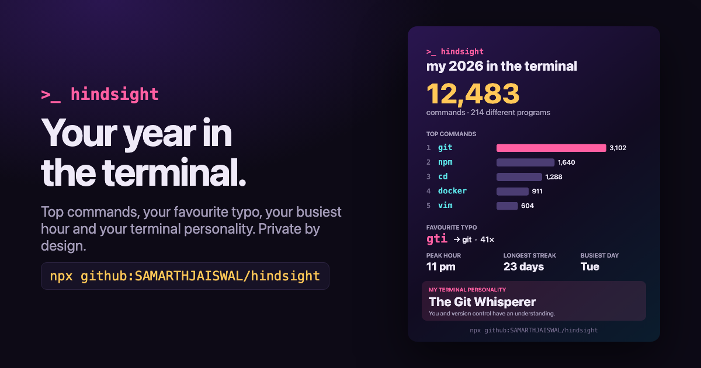

# hindsight

[](https://github.com/SAMARTHJAISWAL/hindsight/actions/workflows/ci.yml)
[](https://samarthjaiswal.github.io/hindsight/)
[](LICENSE)

**Your year in the terminal.** It shows your top commands, your favourite typo, the hour you're busiest, and your terminal personality, then turns them into a card you can share. It's all computed on your machine from your shell history.

```sh
npx github:SAMARTHJAISWAL/hindsight
```

You need Node 18 or newer. There's nothing to install and nothing to sign up for. It works with **zsh, bash, fish and PowerShell**.

[](https://samarthjaiswal.github.io/hindsight/)

<sub>The card above uses made-up numbers.</sub>

## What you get

This is the recap for a made-up year of history ([`test/fixtures/sample_year`](test/fixtures/sample_year)):

```
  hindsight · your 2026 in the terminal
  10,351 commands · 23 different programs · 247 active days

  YOUR TOP COMMANDS
   1  git      ███████████████████████████████████████████ 4,503 (43%)
   2  ls       █████████████ 1,374
   3  npm      ███████████ 1,105
   4  cd       █████████ 909
   5  docker   ████ 452
   ...

  GIT
  status 1,537 · add 739 · commit 636 · push 443 · pull 375

  TYPOS
  You typed gti 67 times when you meant git.
  Also: pyhton3→python3 24
  91 typos in total.

  WHEN YOU WORK
  Busiest hour: 6 pm · busiest day of the week: Wednesday
  midnight ▄▄▁▁▁▁▁▁▃▃▆▆▆▆▇▆▇▇█▇██▆▆ 11 pm
  Longest streak: 18 days in a row · busiest day: 2026-01-15 (64 commands)
  7% of your commands ran between midnight and 5 am.

  FUN FACTS
  sudo !! 56× · rm -rf 62× · cleared the screen 441× · asked for help 26×
  Editor of choice: vim 299 (vs VS Code 227)
  Favourite package manager: npm
  Longest pipeline: 5 pipes
    cat app.log | grep ERROR | sort | uniq -c | sort -rn | head

  YOUR TERMINAL PERSONALITY
  ★ The Git Whisperer
  You and version control have an understanding.
```

Then run `hindsight --card` to open the shareable card in your browser. From there you can download it as an image, copy a summary, or post it.

There are eleven personalities, including the Git Whisperer, the Container Captain, the Night Owl, the Pythonista, the JavaScript Juggler, the Rustacean, the Gopher, the Remote Operator, the Speed Typist and the Wanderer. Run it to find out which one you are.

## Options

| | |
|---|---|
| `hindsight` | this year's recap |
| `hindsight --card` | open the shareable card |
| `hindsight --all` | your whole history |
| `hindsight --year 2025` | a different year |
| `hindsight --file PATH --shell fish` | a specific history file |
| `hindsight --json` | the numbers, as JSON |

**No Node?** [Paste your history into the web page](https://samarthjaiswal.github.io/hindsight/) instead. It's processed in the browser tab, and the page tells you how to copy your history file on Mac, Linux and Windows.

**No timestamps?** By default zsh and bash don't record when you ran each command. hindsight then recaps your whole history and leaves out the time-of-day stats. To get them next year, add `setopt EXTENDED_HISTORY` to `~/.zshrc`, or `HISTTIMEFORMAT="%F %T "` to `~/.bashrc`.

## Private by design

Shell history is full of things you'd never post: API keys, tokens, passwords, internal hostnames, your username in file paths.

- **Nothing is uploaded.** The command runs entirely on your machine. The web page processes pasted history inside the browser tab.
- **The card link carries only totals.** It holds totals, top program names and one short scrubbed snippet, all after the `#`. Browsers never send the part after `#` to the server, so the page that draws your card never receives your data.
- **Secrets are scrubbed** before anything is shown. [`src/redact.js`](src/redact.js) removes:
  - API keys and tokens: GitHub, OpenAI and Anthropic, AWS, Slack, Stripe, Google, JWTs, private keys;
  - `PASSWORD=`-style variables and `--token` / `--password` flags;
  - passwords inside URLs and `Authorization` headers;
  - email addresses and long random strings;
  - your username in paths such as `/Users/you` or `C:\Users\you`.
  The tests check sixteen kinds of secret against it.
- **A pasted token can't become a "command".** If one was ever pasted into the shell, it can't appear in your top-commands list.

## How it works

- **[`src/parse.js`](src/parse.js) reads each shell's history format.**
  - zsh: the plain and timestamped formats, including the special encoding zsh uses for non-ASCII text (otherwise `é` comes out garbled).
  - bash: with and without `HISTTIMEFORMAT` timestamps.
  - fish: its YAML-like history file.
  - PowerShell: PSReadLine history, with backtick continuations.
  - Multi-line commands are joined back together in every format.
- **[`src/stats.js`](src/stats.js) splits each command line into the programs it runs.**
  - Lines are split on `|`, `&&`, `||` and `;`, while respecting quotes.
  - Wrappers such as `sudo`, `time` and `FOO=1` are skipped.
- **Typos** are words within one or two keystrokes of a command you use, including swapped letters (Damerau–Levenshtein distance).
  - They only count when they're rarer than the real command, since something run often is a real tool.
  - That's why `kubectx` isn't reported as a typo of `kubectl`.
- **[`web/`](web)** is the card page. It uses plain ES modules, with no framework and no dependencies, and shares the same parsing and statistics code as the command line.

## Development

```sh
npm test                 # parsers, stats, redaction, link packing, and the CLI end to end
npm run build            # the web page, into _site/
node scripts/sample.mjs  # regenerate the made-up sample year
```

## License

[MIT](LICENSE)
